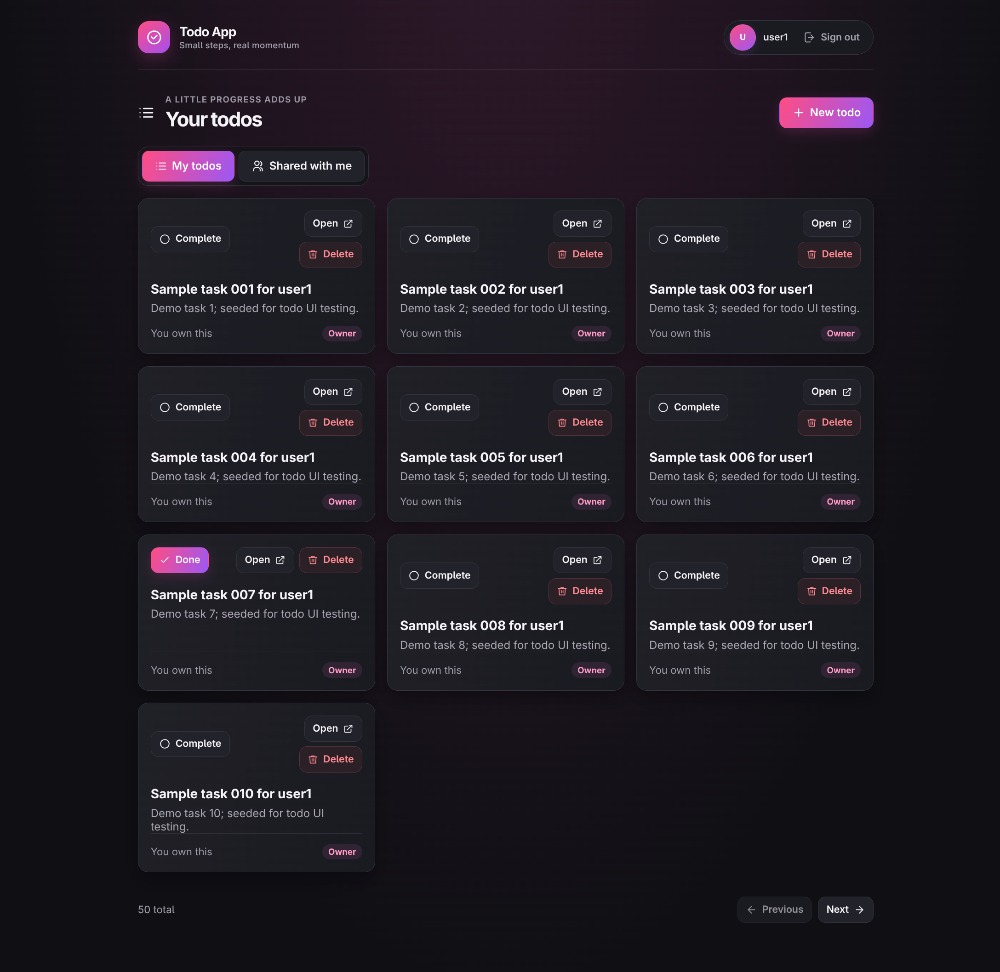

# Todo App

Solid 2 frontend with a Koa API and PostgreSQL. Create and share todos, search users, and paginate lists.



## Setup

Requires Docker Compose. From the repository root:

```sh
cp .env.example .env
```

Replace `JWT_ACCESS_SECRET` and `JWT_REFRESH_SECRET` in `.env` with distinct random values. If you change the Postgres credentials, keep `DATABASE_URL` in sync.

```sh
docker compose up -d
```

Compose starts PostgreSQL, applies migrations, and runs the API and web app. Open <http://localhost:3000>; the API is at <http://localhost:3001>.

## Local frontend development

To run the web app on the host instead of in Compose, start only the database and API (stop the Compose `web` service first if the full stack is already running):

```sh
docker compose up -d postgres api
npm install
npm run dev -w @todo-app/web
```

The web dev server proxies API requests to `http://localhost:3001`.

## Checks

```sh
npm run typecheck -w @todo-app/api
npm run typecheck -w @todo-app/web
npm run build -w @todo-app/api
npm run build -w @todo-app/web
```
